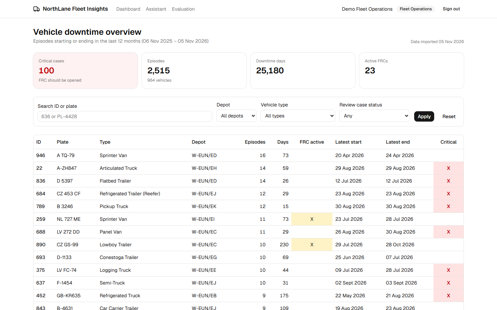
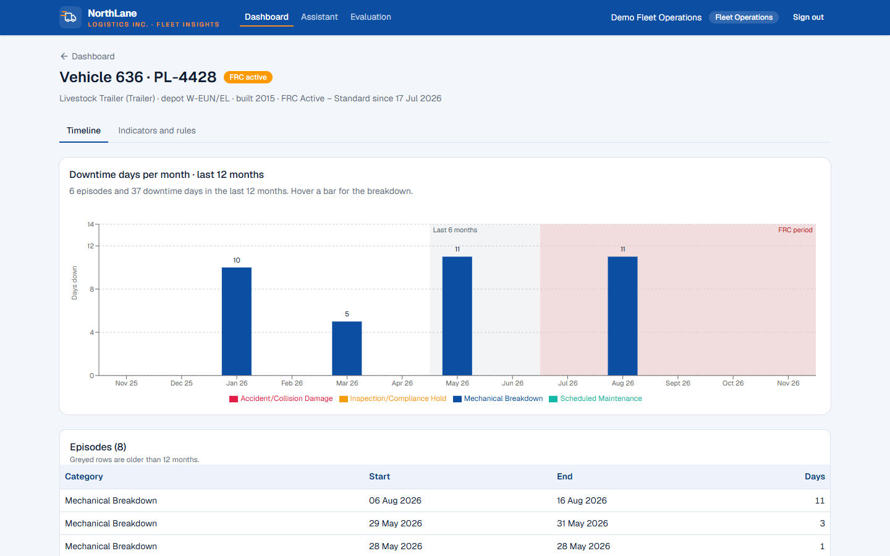
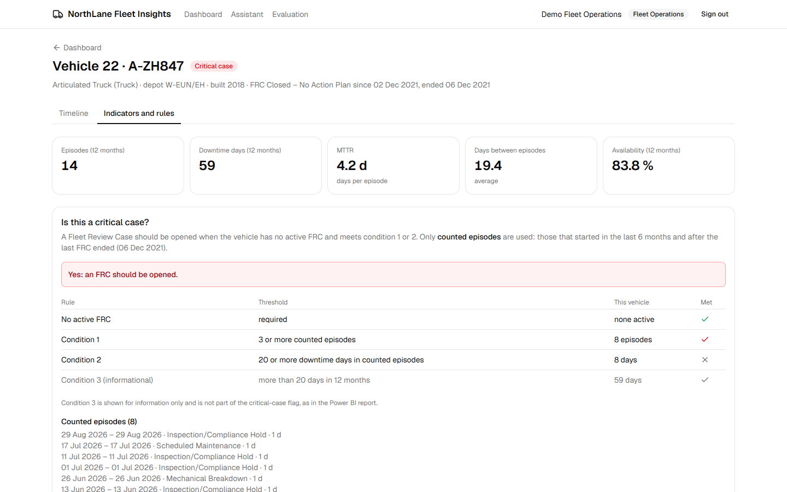
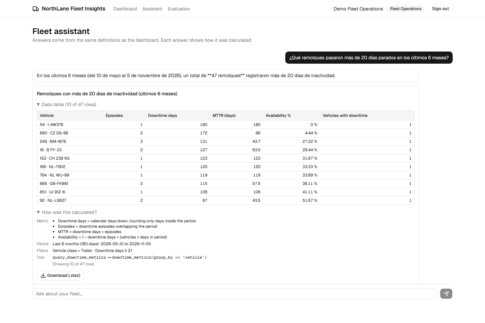
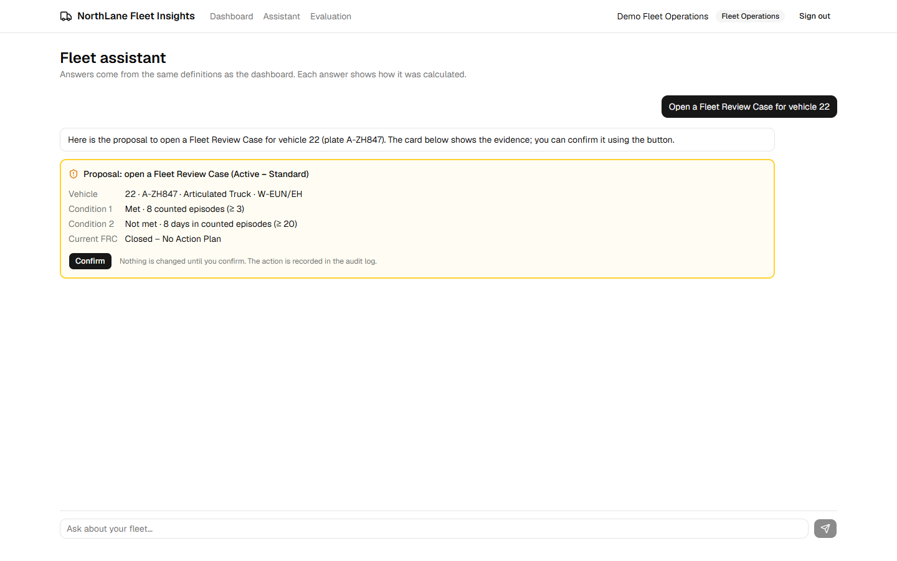
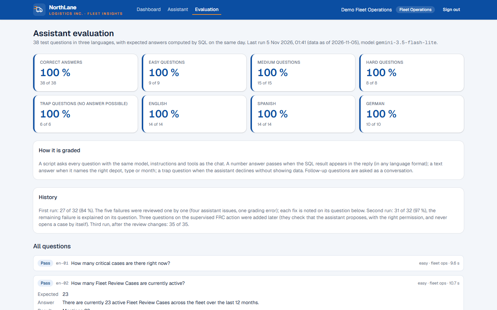
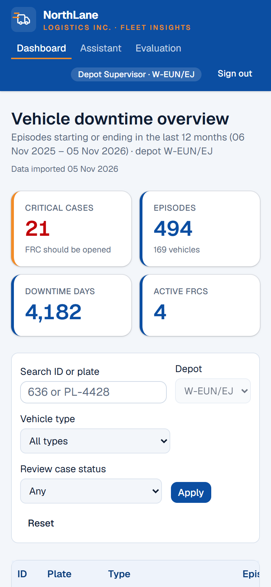
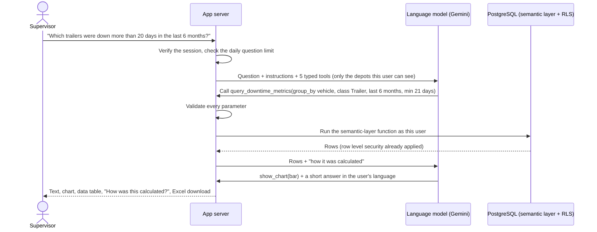
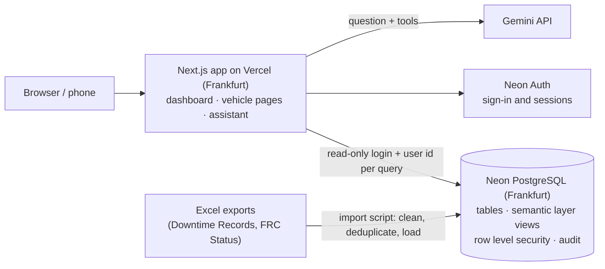

# NorthLane Fleet Insights

**Vehicle downtime analytics for a logistics fleet, with an assistant that answers questions in plain language**: the classic dashboard plus correct numbers on demand, a chart and an explanation of how each number was calculated.

**Live demo: [northlane-fleet-insights.vercel.app](https://northlane-fleet-insights.vercel.app)**: click *Explore the demo* and pick a role. No sign-up needed; the data is fictional.

| Role | What you will see |
|---|---|
| **Fleet Operations** | All 20 depots. Can confirm opening a Fleet Review Case proposed by the assistant. |
| **Depot Supervisor** | Only the vehicles of depot W-EUN/EJ, everywhere: dashboard, vehicle pages and assistant. |



## The problem

*NorthLane Logistics Inc.* (fictional) runs about 960 vehicles of 35 types (semi-trucks, trailers, vans…) across 20 depots. A Power BI report tracks every **downtime episode** and flags **critical cases**: vehicles that should get a **Fleet Review Case (FRC)** because they keep breaking down.

The report works, but depot supervisors need specific answers ("which trailers of my depot were down more than 20 days this half-year?") and do not use filters or DAX. Every question ends up as a request to Fleet Operations.

This project takes that report to a web app: the same dashboard and rules, plus an assistant that answers those questions directly, with the same numbers as the dashboard and only for the vehicles the user is allowed to see.

## What it does

| Area | Highlights |
|---|---|
| **Dashboard** | Critical cases, episodes, downtime days and active FRCs; the vehicle list with the critical-case mark; filters by depot, type and FRC status; search by ID or plate. |
| **Vehicle page** | Downtime days per month with the FRC period and the 6-month rule window shaded; episodes; whether each critical-case condition is met, with the vehicle's values. |
| **Assistant** | Questions in English, Spanish or German, answered in the same language. Each answer: short text, a chart chosen for the question (bar, line, donut or table), the data table, **"How was this calculated?"** (metric, period, filters, source) and a client-side **Excel download**. Follow-up questions keep the context. Questions that the data cannot answer are declined, never guessed. |
| **Supervised actions** | The assistant can **propose** opening an FRC for a critical case, closing one ("remove" = Aborted, nothing is deleted), correcting its dates or recording a past one. Nothing changes until a Fleet Operations user clicks *Confirm*; the database checks the rules, prevents duplicates and records every attempt, with previous and new values, in an audit log. |
| **Evaluation** | 38 test questions in three languages, including trap questions with no possible answer, graded against answers computed by SQL. The results page shows the score and explains every failure. |

| Vehicle: downtime per month | Vehicle: critical-case rules |
|---|---|
|  |  |

| Assistant answer with "How was this calculated?" | Proposal to open a Fleet Review Case |
|---|---|
|  |  |

| Evaluation results | Depot supervisor on the phone |
|---|---|
|  |  |

## How the assistant answers, step by step



The model never writes SQL and never calculates: it only chooses a tool and its parameters. Every number comes from the same database functions as the dashboard, so the chat and the dashboard cannot disagree.

## How it is built



**The business rules live in the database.** The critical-case rules of the Power BI report were translated from DAX to SQL views and functions (the *semantic layer*). Dashboard, assistant and exports read only from there.

**Checked against the original report:** with the report's evaluation date, the SQL rules give the same **100 critical cases** and the same mark for all **16 vehicles** visible in the report's screenshot (`db/verify/critical_cases_vs_power_bi.sql`).

**Permissions by depot, enforced by PostgreSQL.** Every table has row level security. The app connects with a read-only database login, and each request runs with the signed-in user's id, so a supervisor only ever sees their depot, in the dashboard and in the assistant. Without a user, the database returns nothing.

**Data cleaning, documented.** The import script reports every data-quality finding: inconsistent `Days` values (same-day episodes as 0 or 1), duplicates, a vehicle recorded under two depots, placeholder `"-"` values. See [docs/DATA_IMPORT_REPORT.md](docs/DATA_IMPORT_REPORT.md).

## Evaluation

| | Result |
|---|---|
| All questions | **38 of 38 (100 %)** on the last run |
| Trap questions (no answer possible) | 100 % declined without inventing data |
| English / Spanish / German | see the [results page](https://northlane-fleet-insights.vercel.app/evaluation) |

The first run scored 84 %. Each failure was analysed and fixed at its cause (a filter boundary, a missing tool option, counting rows instead of using the total) and the full set was run again after every change: 97 %, then 100 %. Every past failure stays documented on the results page. A perfect score on 38 questions does not mean the assistant is never wrong; it means the known question types are answered correctly, and new ones are added to the set when they fail.

## Tech stack

Next.js (App Router) + TypeScript · Tailwind CSS + shadcn/ui · Recharts · Vercel AI SDK + Google Gemini · Neon PostgreSQL + Neon Auth · dbmate migrations · exceljs · Vercel.

## Run it locally

1. Copy `.env.example` to `.env.local` and fill in the values.
2. Install the dependencies:
   ```bash
   npm install
   ```
3. Create the database objects, the read-only app login, the data and the demo accounts:
   ```bash
   npm run db:migrate && npm run db:app-role && npm run db:import && npm run db:demo-users
   ```
4. Start the app at http://localhost:3000:
   ```bash
   npm run dev
   ```

Other commands: `npm run eval` (evaluation), `npm run ask -- "question"` (ask the assistant from the terminal), `npm run db:sql -- db/verify/<file>.sql` (verification queries).

## Documentation

- [Data model](docs/DATA_MODEL.md) · [Metrics and business rules](docs/METRICS.md) · [Import report](docs/DATA_IMPORT_REPORT.md)
- [What would change in production](docs/PRODUCTION.md)
- [Project brief](docs/PROJECT_BRIEF.md) (in Spanish)
