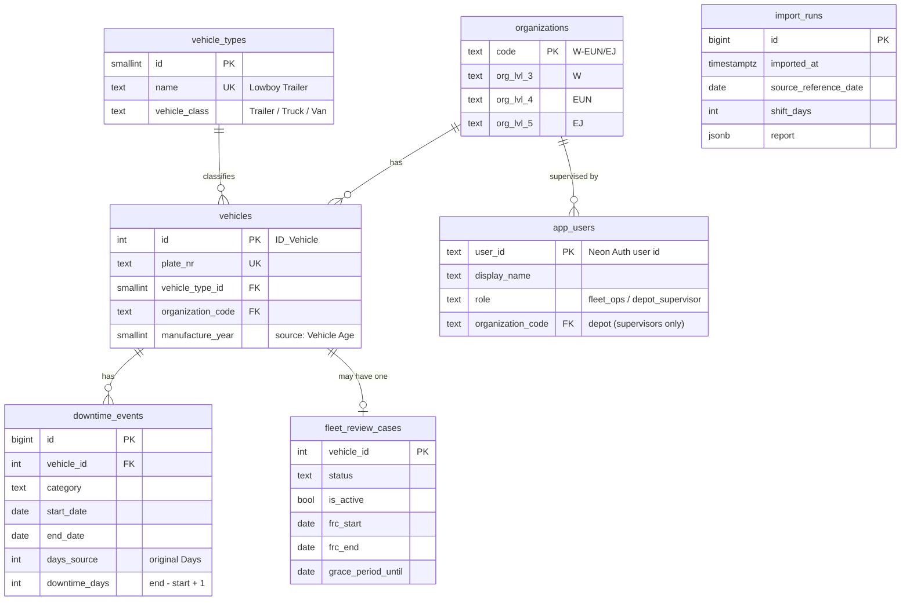

# Data model

Source: two Excel exports (`data/source/`), loaded by `npm run db:import` (`scripts/import.mjs`).
Schema: `db/migrations/20261104190000_core_tables.sql`. Latest import results: [DATA_IMPORT_REPORT.md](DATA_IMPORT_REPORT.md).

## Diagram

Compared with the Power BI model: the `Date` table is not needed (SQL filters dates directly), `Data Refresh` becomes `import_runs`, and the organization hangs off the vehicle instead of each downtime row.

## Source → table mapping

| Source column | Table.column | Cleaning |
|---|---|---|
| Org | `vehicles.organization_code` → `organizations` | Split into Org Lvl 3/4/5; taken from the vehicle's most recent episode |
| ID_Vehicle | `vehicles.id` | — |
| Plate Nr | `vehicles.plate_nr` | Unique per vehicle (checked) |
| Type | `vehicle_types.name` | Grouped into `vehicle_class` (rules below) |
| Vehicle Age | `vehicles.manufacture_year` | It is a year (2009–2025), not an age |
| Downtime Category | `downtime_events.category` | Trailing spaces trimmed; 4 allowed values |
| Days | `downtime_events.days_source` | Kept for audit only |
| Start Date / End Date | `downtime_events.start_date / end_date` | Shifted (see below); end ≥ start enforced |
| Review Case Status | `fleet_review_cases.status` | 6 allowed values; `is_active` derived |
| FRC Start / FRC End / Grace Period Until | `fleet_review_cases.*` | `"-"` → NULL; shifted |
| Org / Plate Nr (FRC file) | — | Not stored: taken from the vehicle (differences reported) |
| Unnamed helper columns | — | Ignored (e.g. `=MIN(I:I)` / `=MAX(I:I)` cells) |

## Cleaning rules

1. **Downtime days are calendar days, inclusive:** `downtime_days = end_date − start_date + 1`. The source mixes conventions: same-day episodes appear as 0 days (345) or 1 day (597), and 16 long episodes are 2 days over. The original Power BI detail view already shows same-day episodes as 1 day, so the normalized value matches the report.
2. **Duplicates removed:** same vehicle, category, start and end counts once (10 cases, one of them recorded under two depots).
3. **One organization per vehicle:** its most recent episode's depot. RLS by depot uses this column.
4. **Vehicle classes:** names with "Trailer", plus Enclosed Car Carrier and Hazardous Materials Tanker → Trailer; the six "… Van" types → Van; everything else → Truck.
5. **Date shift:** every date moves by the same number of days so that the day the Power BI report was evaluated (2026-07-22, its `TODAY()`, two weeks after its "Last Update" of 2026-07-08) becomes the import day. With that date the critical-case rules reproduce the report exactly (see [METRICS.md](METRICS.md)). Ongoing episodes keep their planned end in the future, as in the original. Re-running the import realigns the data with today.

## Constraints that protect the data

- `downtime_events`: end ≥ start; allowed categories; unique (vehicle, category, start, end).
- `fleet_review_cases`: one per vehicle; allowed statuses; end ≥ start; active ⇔ no end date.
- `vehicles`: unique plate; foreign keys to type and organization.
